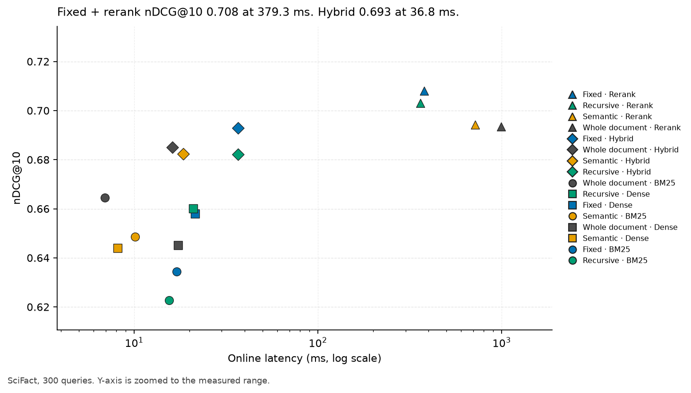
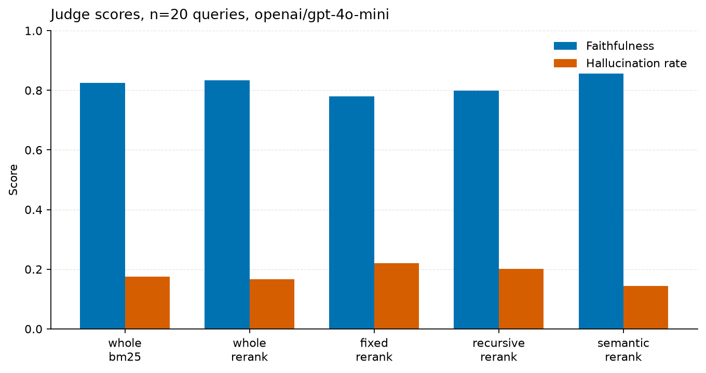

# rag-eval-harness

[](https://github.com/ramiro-gonzalez/rag-eval-harness/actions/workflows/ci.yml)

Measured comparison of chunking and retrieval for RAG. The CLI and Python package stay named `raglab`, so `raglab run` is unchanged.

## TL;DR

On SciFact (5,183 abstracts, 300 labeled queries, 4 CPUs), fixed-size chunks plus a cross-encoder reach nDCG@10 **0.708** at **379.3 ms** per query. Hybrid retrieval on the same chunks reaches **0.693** at **36.8 ms**. A separate 20-query judge pass (`openai/gpt-4o-mini` via OpenRouter, not checked against human labels) scored semantic + rerank highest on faithfulness (**0.855**) and fixed + rerank lowest of the five judged stacks (**0.780**).



## The problem

Which chunking policy and which retriever put the labeled evidence highest, and what does that cost in latency? The harness runs the grid on a public dataset, writes CSV/JSON/Markdown, and draws the charts from those files.

## Setup

**Dataset.** SciFact via BEIR. Queries are scientific claims. Documents are paper abstracts. Labels are binary. The 300-query file records 5,183 documents, mean length 214.6 words, and 1.13 relevant documents per query.

**Models.** Embeddings: `sentence-transformers/all-MiniLM-L6-v2`. Reranker: `Xenova/ms-marco-MiniLM-L-6-v2`. Both local, through fastembed 0.9.1 and numpy 2.5.4. BM25 uses k1 1.5 and b 0.75. Hybrid is reciprocal rank fusion with k 60. The reranker rescores the top 20 hybrid hits.

**Chunking, recorded in both result files.** Whole document. Fixed windows of 100 words with overlap 25. Recursive splits with the same word budget. Semantic splits at the 95th percentile of adjacent-sentence distance, capped at 220 words.

**Two machines, recorded separately.** The 300-query retrieval run is Python 3.12.3 on 4 CPUs. The generation run is Python 3.13.5 on 8 CPUs. Do not compare milliseconds across those two tables.

## Retrieval results (300 queries)

Macro-average on all 300 labeled SciFact test queries. Recall, MRR, and nDCG are document-level after collapsing chunks to their source document. Context precision uses the gold document label on each chunk, not an LLM. Online latency is the mean of 10 single-query calls on that machine.

| Chunker | Retriever | Recall@10 | MRR@10 | nDCG@10 | Context precision@10 | Online latency (ms) |
| --- | --- | ---: | ---: | ---: | ---: | ---: |
| whole | bm25 | 0.785 | 0.633 | 0.664 | 0.628 | 6.9 |
| whole | dense | 0.783 | 0.605 | 0.645 | 0.599 | 17.4 |
| whole | hybrid | 0.815 | 0.647 | 0.685 | 0.644 | 16.2 |
| whole | rerank | 0.819 | 0.664 | 0.693 | 0.656 | 993.9 |
| fixed | bm25 | 0.767 | 0.599 | 0.634 | 0.539 | 17.1 |
| fixed | dense | 0.819 | 0.611 | 0.658 | 0.562 | 21.5 |
| fixed | hybrid | 0.831 | 0.652 | 0.693 | 0.587 | 36.8 |
| fixed | rerank | 0.834 | 0.675 | 0.708 | 0.612 | 379.3 |
| recursive | bm25 | 0.755 | 0.586 | 0.623 | 0.529 | 15.5 |
| recursive | dense | 0.817 | 0.616 | 0.660 | 0.552 | 20.9 |
| recursive | hybrid | 0.808 | 0.644 | 0.682 | 0.577 | 36.7 |
| recursive | rerank | 0.838 | 0.666 | 0.703 | 0.607 | 360.6 |
| semantic | bm25 | 0.780 | 0.612 | 0.649 | 0.583 | 10.1 |
| semantic | dense | 0.812 | 0.592 | 0.644 | 0.553 | 8.1 |
| semantic | hybrid | 0.812 | 0.645 | 0.682 | 0.607 | 18.5 |
| semantic | rerank | 0.819 | 0.663 | 0.694 | 0.620 | 717.5 |

On this table, hybrid is above both BM25 and dense for every chunker. BM25 is highest on the whole abstract (nDCG@10 0.664) and lower on fixed (0.634) and recursive (0.623) chunks. The best nDCG@10 is fixed + rerank at 0.708. The best recall@10 is recursive + rerank at 0.838. The best context precision@10 is whole + rerank at 0.656. Full rows, including @5, are in `results/scifact/metrics.csv`.

The 300-query run did not include HyDE or RAG-Fusion. Those are in the 50-query run below.

## Generation results (20 judged queries)

This block is a small sample. Twenty queries, one judge model, and no comparison to human labels. Hallucination rate here is 1 minus faithfulness on the same claims, so the two columns move together. Answer relevancy does not.

The retrieval grid under these scores is 50 queries drawn with seed 7 from the 300, on the full 5,183-document corpus (mean 1.22 relevant documents per query in that sample). Five stacks were judged, with 5 chunks of context. Zero judge errors. Provider token counts: 255,764 input, 19,364 output, 331 calls, 409 cache hits. The file's cost estimate at $0.15 / $0.60 per million tokens is $0.0500.

| Chunker | Retriever | Faithfulness | Answer relevancy | Hallucination rate | Errors |
| --- | --- | ---: | ---: | ---: | ---: |
| whole | bm25 | 0.825 | 0.488 | 0.175 | 0 |
| whole | rerank | 0.833 | 0.426 | 0.167 | 0 |
| fixed | rerank | 0.780 | 0.641 | 0.220 | 0 |
| recursive | rerank | 0.798 | 0.529 | 0.202 | 0 |
| semantic | rerank | 0.855 | 0.589 | 0.145 | 0 |



On that same 50-query sample, whole-document hybrid nDCG@10 is 0.745, HyDE is 0.703, and RAG-Fusion is 0.707. Warm-cache online latency for whole-document HyDE is 39.9 ms and for RAG-Fusion is 22.8 ms. The result file states that those latency figures do not include the chat call. The full 50-query grid, including every chunker, is in `results/generation/results.md`.

## How to reproduce

```bash
python -m venv .venv
source .venv/bin/activate
pip install -e ".[dev]"
raglab run --config configs/scifact.yaml
python scripts/make_charts.py
```

Charts read only `results/scifact/metrics.csv` and `results/generation/metrics.json`.

Generation run, which also scores HyDE and RAG-Fusion:

```bash
export OPENROUTER_API_KEY=...
raglab run --config configs/generation.yaml
```

`OPENROUTER_API_KEY` uses `https://openrouter.ai/api/v1` and default model `openai/gpt-4o-mini`. `OPENAI_API_KEY` uses `https://api.openai.com/v1` and `gpt-4o-mini`. If both are set, the OpenRouter key is used. `RAGBENCH_API_KEY`, `RAGBENCH_API_BASE`, and `RAGBENCH_LLM_MODEL` override those defaults. The key is not written into the results. Outputs go to `results/generation/`.

CI (`.github/workflows/ci.yml`) runs on push and pull request: ruff, pytest, and `raglab run --config configs/smoke.yaml --check configs/smoke_thresholds.json`, on Python 3.11. The smoke gate does not use an API key.

## Limitations

- One dataset. The abstracts are short (mean 214.6 words), so this does not say what happens on long documents.
- The judge covers 20 queries and was not checked against human labels.
- Hallucination rate in these files is 1 minus faithfulness, not a second judge.
- Latency from the 300-query run and the 50-query run comes from different machines (4 CPUs and 8 CPUs).
- HyDE and RAG-Fusion were not part of the 300-query grid.

## What's next

Check the judge against human labels on a SciFact sample. Run the same grid on a dataset with longer documents. Add another retriever through `register_retriever` and score it with `raglab run` before treating it as measured.
