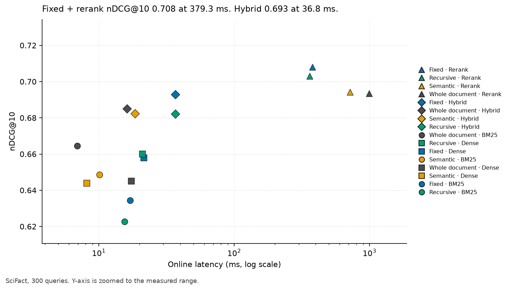
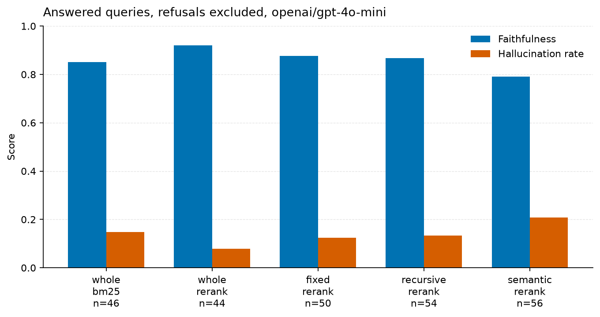

# rag-eval-harness

[](https://github.com/ramiro-gonzalez/rag-eval-harness/actions/workflows/ci.yml)

Measured comparison of chunking and retrieval for RAG. The CLI and Python package stay named `raglab`, so `raglab run` is unchanged.

## TL;DR

On SciFact (5,183 abstracts, 300 labeled queries, 4 CPUs), fixed-size chunks plus a cross-encoder reach nDCG@10 **0.708** at **379.3 ms** per query. Hybrid retrieval on the same chunks reaches **0.693** at **36.8 ms**. On the 100-query judge pass (`openai/gpt-4o-mini` via OpenRouter, temperature 0, context_k=5), an exact `I do not know.` is an abstention and is left out of faithfulness. Answered-query faithfulness with judge v2 in `results/gen-100-judge-v2/results.md` runs from **0.792** (semantic + rerank, n=56) to **0.920** (whole + rerank, n=44). The v1 numbers on the same answers were higher. A 40-item check against Claude Opus labels, which is one model and not human annotation, is below.



## The problem

Which chunking policy and which retriever put the labeled evidence highest, and what does that cost in latency? The harness runs the grid on a public dataset, writes CSV/JSON/Markdown, and draws the charts from those files.

## Setup

**Dataset.** SciFact via BEIR. Queries are scientific claims. Documents are paper abstracts. Labels are binary. The 300-query file records 5,183 documents, mean length 214.6 words, and 1.13 relevant documents per query.

**Models.** Embeddings: `sentence-transformers/all-MiniLM-L6-v2`. Reranker: `Xenova/ms-marco-MiniLM-L-6-v2`. Both local, through fastembed 0.9.1 and numpy 2.5.4. BM25 uses k1 1.5 and b 0.75. Hybrid is reciprocal rank fusion with k 60. The reranker rescores the top 20 hybrid hits.

**Chunking, recorded in both result files.** Whole document. Fixed windows of 100 words with overlap 25. Recursive splits with the same word budget. Semantic splits at the 95th percentile of adjacent-sentence distance, capped at 220 words.

**Two machines, recorded separately.** The 300-query retrieval run is Python 3.12.3 on 4 CPUs. The generation runs are Python 3.13.5 on 8 CPUs. Do not compare milliseconds across those two tables.

How each number below is computed: [docs/metrics.md](docs/metrics.md).

## Retrieval results (300 queries)

Macro-average on all 300 labeled SciFact test queries. Recall, MRR, and nDCG are document-level after collapsing chunks to their source document. Context precision uses the gold document label on each chunk, not an LLM. Online latency is the mean of 10 single-query calls on that machine.

| Chunker | Retriever | Recall@10 | MRR@10 | nDCG@10 | Context precision@10 | Online latency (ms) |
| --- | --- | ---: | ---: | ---: | ---: | ---: |
| whole | bm25 | 0.785 | 0.633 | 0.664 | 0.628 | 6.9 |
| whole | dense | 0.783 | 0.605 | 0.645 | 0.599 | 17.4 |
| whole | hybrid | 0.815 | 0.647 | 0.685 | 0.644 | 16.2 |
| whole | rerank | 0.819 | 0.664 | 0.693 | 0.656 | 993.9 |
| fixed | bm25 | 0.767 | 0.599 | 0.634 | 0.539 | 17.1 |
| fixed | dense | 0.819 | 0.611 | 0.658 | 0.562 | 21.5 |
| fixed | hybrid | 0.831 | 0.652 | 0.693 | 0.587 | 36.8 |
| fixed | rerank | 0.834 | 0.675 | 0.708 | 0.612 | 379.3 |
| recursive | bm25 | 0.755 | 0.586 | 0.623 | 0.529 | 15.5 |
| recursive | dense | 0.817 | 0.616 | 0.660 | 0.552 | 20.9 |
| recursive | hybrid | 0.808 | 0.644 | 0.682 | 0.577 | 36.7 |
| recursive | rerank | 0.838 | 0.666 | 0.703 | 0.607 | 360.6 |
| semantic | bm25 | 0.780 | 0.612 | 0.649 | 0.583 | 10.1 |
| semantic | dense | 0.812 | 0.592 | 0.644 | 0.553 | 8.1 |
| semantic | hybrid | 0.812 | 0.645 | 0.682 | 0.607 | 18.5 |
| semantic | rerank | 0.819 | 0.663 | 0.694 | 0.620 | 717.5 |

On this table, hybrid is above both BM25 and dense for every chunker. BM25 is highest on the whole abstract (nDCG@10 0.664) and lower on fixed (0.634) and recursive (0.623) chunks. The best nDCG@10 is fixed + rerank at 0.708. The best recall@10 is recursive + rerank at 0.838. The best context precision@10 is whole + rerank at 0.656. Full rows, including @5, are in `results/scifact/metrics.csv`.

The 300-query run did not include HyDE or RAG-Fusion. Those are in the 50-query run below.

## Generation results (100 judged queries)

Faithfulness and hallucination rate below are judge v2, from `results/gen-100-judge-v2/results.md`. Same five stacks, same answers, judge `openai/gpt-4o-mini` via OpenRouter, temperature 0, context_k=5. Refusal rate and answer relevancy are unchanged from the v1 answered-only scores. v2 re-scored every answered row, so fixed + rerank is n=50. The v1 judge left that stack at n=49 because one row had no claim verdict (`results/generation-100/metrics.json`).

The retrieval grid under these scores is 100 queries drawn with seed 7 from the 300, on the full 5,183-document corpus (mean 1.15 relevant documents per query in that sample). From `results/generation-100/results.md`: model `openai/gpt-4o-mini`, provider `openrouter`, 100 queries, context_k=5. Token counts from the provider: 1260305 input, 46274 output, 1122 calls, 376 cache hits. Estimated cost $0.2168 at $0.15/$0.60 per million. Re-scoring faithfulness with v2 cost 398 calls, 380403 input and 19616 output tokens, about $0.0688 (`results/gen-100-judge-v2/results.md`).

An exact answer `I do not know.` is an abstention and is left out of faithfulness, hallucination rate, and answer relevancy. Judge v1 extracted claims in one step and often dropped the answer's yes/no polarity, so the v1 faithfulness column below is inflated. v2 keeps that polarity, then marks each claim supported, contradicted, or not_found. The score is the share marked supported.

| Chunker | Retriever | Refusal rate | Answered | Faithfulness v2 | Hallucination rate v2 | Answer relevancy | Faithfulness v1 |
| --- | --- | ---: | ---: | ---: | ---: | ---: | ---: |
| whole | bm25 | 0.54 | 46 | 0.851 | 0.149 | 0.791 | 0.953 |
| whole | rerank | 0.56 | 44 | 0.920 | 0.080 | 0.798 | 0.909 |
| fixed | rerank | 0.50 | 50 | 0.877 | 0.123 | 0.796 | 0.918 |
| recursive | rerank | 0.46 | 54 | 0.867 | 0.133 | 0.797 | 0.957 |
| semantic | rerank | 0.44 | 56 | 0.792 | 0.208 | 0.787 | 0.950 |



154/250 refusals had a gold-relevant document in the 5 contexts (whole/bm25 35/54, whole/rerank 33/56, fixed/rerank 29/50, recursive/rerank 29/46, semantic/rerank 28/44). Each context is matched to a document by its alphanumeric tokens, then checked against the SciFact test qrels. Most abstentions still had a labeled abstract in the window, so the strict answer prompt is doing the refusing along with retrieval misses. Means that scored every row, including abstentions, are in `all_rows` on each pair in `results/generation-100/metrics.json`.

An earlier 20-query pass (`results/generation/results.md`, same five stacks and the same model) reported faithfulness from 0.780 to 0.855. That file used judge v1 and counted abstentions as unfaithful. It is not the headline.

## Judge validation

Forty answers from the 100-query run were labeled by Claude Opus, blind to the judge scores, with a strict rubric: supported by the 5 contexts only. This is one strong model, not human annotation. The sheet is 24 items where v1 and RAGAS disagreed most (12 on faithfulness, 12 on answer relevancy) and 16 random items, 8 per stack (`results/judge-validation/key.csv`).

Agreement with those labels, from `results/judge-validation/analysis_opus_v2.json`. Yes maps to 1, partial to 0.5, no to 0. Within 0.25 is the share of items whose absolute error is at most 0.25. Accuracy at 0.5 treats a score of at least 0.5 as positive.

| Judge | n | MAE | Within 0.25 | Spearman | Accuracy at 0.5 |
| --- | ---: | ---: | ---: | ---: | ---: |
| v1 | 40 | 0.2875 | 0.575 | -0.132946 | 0.825 |
| v2 | 40 | 0.175 | 0.725 | 0.507453 | 0.875 |
| RAGAS | 40 | 0.410417 | 0.4 | 0.310177 | 0.675 |

Five items whose answer contradicted the contexts had reference label no. v1 scored them high; v2 did not. Old to new, from the same file: item 3, 1.0 to 0.0; item 7, 0.6666666666666666 to 0.0; item 22, 1.0 to 0.6666666666666666; item 35, 1.0 to 0.5; item 36, 1.0 to 0.0.

v2 still has false alarms where the reference label is yes and the v2 score is below 0.5. Items 2 and 33 are answers that say the context does not provide enough information; v2 extracted that sentence as a claim and marked it not_found, so the score is 0.0. Item 9 is also 0.0: the West Nile claim was marked not_found. `scripts/ragas_agreement.py` has not been run on every row of `results/generation-100/answers.jsonl`.

On that 50-query retrieval sample, whole-document hybrid nDCG@10 is 0.745, HyDE is 0.703, and RAG-Fusion is 0.707. Warm-cache online latency for whole-document HyDE is 39.9 ms and for RAG-Fusion is 22.8 ms. The result file states that those latency figures do not include the chat call. The full 50-query grid, including every chunker, is in `results/generation/results.md`. The 100-query run did not include HyDE or RAG-Fusion.

## Stage-wise ablation

`raglab ablate` turns chunking, query transform, retrieval, and rerank on and off from `configs/ablation.yaml`. It picks each stage on a dev split, then scores that choice on a held-out test split. This local run used 80 of the 809 SciFact train queries as dev (seed 7) and all 300 official test queries as the held-out set. HyDE, RAG-Fusion, and step-back were not in the config. Every local stage is $0.

| Stage | Chosen | Dev nDCG@10 | Test nDCG@10 | Delta test nDCG@10 | Test latency (ms) | Est. USD |
| --- | --- | ---: | ---: | ---: | ---: | ---: |
| baseline | whole/none/bm25/none | 0.597 | 0.664 |  | 6.7 | 0.00 |
| chunking | whole | 0.597 | 0.664 | 0.000 | 6.7 | 0.00 |
| query_transform | none | 0.597 | 0.664 | 0.000 | 7.4 | 0.00 |
| retrieval | rrf | 0.637 | 0.685 | 0.021 | 11.9 | 0.00 |
| rerank | cross_encoder | 0.637 | 0.693 | 0.008 | 654.2 | 0.00 |

Dev kept whole-document chunking. Switching retrieval from BM25 to RRF raised test nDCG@10 by 0.021, to 0.685. The cross-encoder then added 0.008 on the test set, at 654.2 ms per query in this run. Those three test scores match the 300-query table's whole/bm25, whole/hybrid, and whole/rerank rows. The latency column is the mean over all 300 test queries in `results/ablation/metrics.csv`, not the 10-query sample in the table above. Markdown chunking was one of the dev candidates and was not chosen. Sentence-window and parent-document chunkers are implemented and were not part of this run, so they have no numbers here.

```bash
raglab ablate --config configs/ablation.yaml
```

Parity tests in `tests/test_parity.py` compare our nDCG@10, MRR@10, and Recall@10 to `pytrec_eval` within 1e-8, and compare BM25 to `rank_bm25` up to a stated IDF difference (`log(1+x)` here, `log(x)` with an epsilon floor there). `scripts/ragas_agreement.py` can compare our judge to RAGAS. The 100-query run saved per-query answers in `results/generation-100/answers.jsonl`, but that comparison has not been run, and no key is required for the rest of the repo, so that script has not produced any numbers.

## How to reproduce

```bash
python -m venv .venv
source .venv/bin/activate
pip install -e ".[dev]"
raglab run --config configs/scifact.yaml
python scripts/make_charts.py
```

Charts read `results/scifact/metrics.csv`, `results/generation/metrics.json`, `results/generation-100/metrics.json`, and `results/gen-100-judge-v2/metrics.json`. The faithfulness chart above is drawn from `results/gen-100-judge-v2/metrics.json`.

100-query generation run. It writes `results/generation-100/`, including `answers.jsonl`:

```bash
export OPENROUTER_API_KEY=...
raglab run --config configs/generation_100.yaml
```

The earlier 20-query sample, which also scores HyDE and RAG-Fusion, is `raglab run --config configs/generation.yaml` and writes `results/generation/`.

`OPENROUTER_API_KEY` uses `https://openrouter.ai/api/v1` and default model `openai/gpt-4o-mini`. `OPENAI_API_KEY` uses `https://api.openai.com/v1` and `gpt-4o-mini`. If both are set, the OpenRouter key is used. `RAGBENCH_API_KEY`, `RAGBENCH_API_BASE`, and `RAGBENCH_LLM_MODEL` override those defaults. The key is not written into the results. Temperature is 0. Paid runs stop if the pre-run estimate exceeds $2.

CI (`.github/workflows/ci.yml`) runs on push and pull request: ruff, pytest, `raglab run --config configs/smoke.yaml --check configs/smoke_thresholds.json`, and `raglab search --config examples/baby-food-rag.yaml --dry-run`, on Python 3.11. The smoke gate and the search dry-run do not use an API key and do not download documents.

## Plug in your own corpus

`raglab search` takes a knowledge base and labeled questions, tries chunking and retrieval combinations, and writes a leaderboard. The documents are referenced by a manifest or a URL and are not committed.

The manifest is YAML with a `sources` list. Each source has `id`, `title`, `url`, `filename`, `role`, `download`, and an optional `sha256`. PDF, Markdown, HTML, and plain text are accepted. PDF extraction needs the optional extra: `pip install -e ".[dev,pdf]"`. Each page is turned into Markdown and keeps its `source_id` and 1-based page, and every chunk keeps that page span.

Questions are a YAML list under `questions`. Each item has `id`, `question`, `answerable`, and `gold`. A gold item is `source_id` plus `pdf_page` (or `page`), or `chunk_id` / `text_id`. `search.gold.match` is `source_page` or `chunk_id`. `page_tolerance` widens a page match. The leaderboard also writes `recall_any_source`, which counts a hit when the page matches and the source id is ignored.

The chunking grid is `markdown`, `recursive`, `fixed`, and `semantic`. `chunk_sizes` and `overlaps` are word budgets; an overlap of `0.1` keeps 10% of the window. Fixed, recursive, and markdown stay inside a page. `search.cross_page: true` is the opt-in that lets fixed windows cross pages. Semantic splits each page with the existing sentence-distance chunker and a local hash embedder, so that step does not load the dense model or use the overlap list. PDF and text headings are short title lines: two to eight words, not a number, a one-word label, or a table row. Consecutive title lines become one heading, and short sections are merged up to the chunk size.

Retrieval is BM25, dense, hybrid reciprocal rank fusion, HyDE, and RAG-Fusion. With `language: pt`, BM25 drops Portuguese stopwords and then stems. The dense model defaults to `intfloat/multilingual-e5-large` and uses the `query: ` and `passage: ` prefixes when the config sets them. HyDE embeds one hypothetical passage. RAG-Fusion writes extra queries, retrieves each one, and fuses them with reciprocal rank fusion. Both call OpenRouter when `OPENROUTER_API_KEY` is set. Completions are cached under `llm.cache_dir`. The key is not written into that cache. Without a key those two retrievers are recorded as skipped.

`search.mode: staged` scores every chunking config with `stage1_retriever`, keeps the best `top_k_per_family` configs of each chunker family, sweeps the other retrievers on those, then adds two per-source merges of the winner. `mode: full` crosses the whole grid. Each scored config reports recall@5, recall@10, MRR@10, nDCG@10, latency per query, mean words per chunk, and mean words in the first 10 hits. `word_budget` (2000 in the example) also writes `recall_budget@10`: the same recall after the hit list is cut so the retrieved text stays inside that many words. A paired bootstrap 95% interval compares that config's per-query nDCG@10 with the current best. The run writes `leaderboard.csv`, `leaderboard.md`, `per_query.json`, and `leaderboard.png`. The chart is drawn from the CSV. Redraw it with `python scripts/make_search_chart.py <leaderboard.csv>`.

The first example points at the [baby-food-rag](https://github.com/ramigonzalez/baby-food-rag) manifest and question file. Running it downloads the core PDFs into `data/cache/baby-food/` on the machine where you start it:

```bash
pip install -e ".[dev,pdf]"
export OPENROUTER_API_KEY=...   # optional; HyDE and RAG-Fusion are skipped without it
raglab search --config examples/baby-food-rag.yaml
```

`raglab search --config examples/baby-food-rag.yaml --dry-run` prints how many configs the file describes and does not download documents or call an API.

## Limitations

- The measured tables above are still SciFact. The abstracts are short (mean 214.6 words). `examples/baby-food-rag.yaml` is a longer Portuguese corpus, and this repository does not include a sweep of it.
- The headline faithfulness numbers are judge v2 on 100 queries (`results/gen-100-judge-v2/results.md`). They were checked against Claude Opus labels on 40 items, not against human labels. Faithfulness excludes exact `I do not know.` abstentions. The 20-query file still uses judge v1.
- Hallucination rate in these files is 1 minus faithfulness, not a second judge.
- Latency from the 300-query run and the 50-query run comes from different machines (4 CPUs and 8 CPUs).
- HyDE and RAG-Fusion were not part of the 300-query grid.

## What's next

Check the judge against human labels on a SciFact sample. The 40-item Opus sheet is not that check. Run `raglab search --config examples/baby-food-rag.yaml` on a machine that can load `intfloat/multilingual-e5-large` before treating a baby-food ranking as measured. Add another retriever through `register_retriever` and score it with `raglab run` before treating it as measured.
