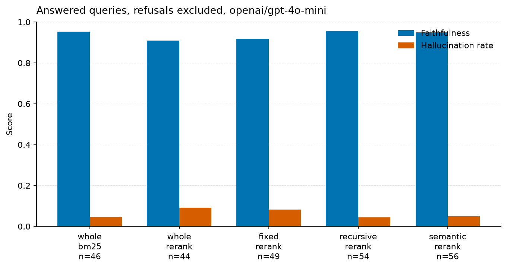

# rag-eval-harness

[](https://github.com/ramiro-gonzalez/rag-eval-harness/actions/workflows/ci.yml)

Measured comparison of chunking and retrieval for RAG. The CLI and Python package stay named `raglab`, so `raglab run` is unchanged.

## TL;DR

On SciFact (5,183 abstracts, 300 labeled queries, 4 CPUs), fixed-size chunks plus a cross-encoder reach nDCG@10 **0.708** at **379.3 ms** per query. Hybrid retrieval on the same chunks reaches **0.693** at **36.8 ms**. On the 100-query judge pass (`openai/gpt-4o-mini` via OpenRouter, temperature 0, context_k=5), an exact `I do not know.` is an abstention and is left out of faithfulness. Answered-query faithfulness in `results/generation-100/results.md` runs from **0.909** (whole + rerank, n=44) to **0.957** (recursive + rerank, n=54). The judge is not yet validated against human labels, and RAGAS agreement is pending.


## The problem

Which chunking policy and which retriever put the labeled evidence highest, and what does that cost in latency? The harness runs the grid on a public dataset, writes CSV/JSON/Markdown, and draws the charts from those files.

## Setup

**Dataset.** SciFact via BEIR. Queries are scientific claims. Documents are paper abstracts. Labels are binary. The 300-query file records 5,183 documents, mean length 214.6 words, and 1.13 relevant documents per query.

**Models.** Embeddings: `sentence-transformers/all-MiniLM-L6-v2`. Reranker: `Xenova/ms-marco-MiniLM-L-6-v2`. Both local, through fastembed 0.9.1 and numpy 2.5.4. BM25 uses k1 1.5 and b 0.75. Hybrid is reciprocal rank fusion with k 60. The reranker rescores the top 20 hybrid hits.

**Chunking, recorded in both result files.** Whole document. Fixed windows of 100 words with overlap 25. Recursive splits with the same word budget. Semantic splits at the 95th percentile of adjacent-sentence distance, capped at 220 words.

**Two machines, recorded separately.** The 300-query retrieval run is Python 3.12.3 on 4 CPUs. The generation runs are Python 3.13.5 on 8 CPUs. Do not compare milliseconds across those two tables.

## Retrieval results (300 queries)

Macro-average on all 300 labeled SciFact test queries. Recall, MRR, and nDCG are document-level after collapsing chunks to their source document. Context precision uses the gold document label on each chunk, not an LLM. Online latency is the mean of 10 single-query calls on that machine.

| Chunker | Retriever | Recall@10 | MRR@10 | nDCG@10 | Context precision@10 | Online latency (ms) |
| --- | --- | ---: | ---: | ---: | ---: | ---: |
| whole | bm25 | 0.785 | 0.633 | 0.664 | 0.628 | 6.9 |
| whole | dense | 0.783 | 0.605 | 0.645 | 0.599 | 17.4 |
| whole | hybrid | 0.815 | 0.647 | 0.685 | 0.644 | 16.2 |
| whole | rerank | 0.819 | 0.664 | 0.693 | 0.656 | 993.9 |
| fixed | bm25 | 0.767 | 0.599 | 0.634 | 0.539 | 17.1 |
| fixed | dense | 0.819 | 0.611 | 0.658 | 0.562 | 21.5 |
| fixed | hybrid | 0.831 | 0.652 | 0.693 | 0.587 | 36.8 |
| fixed | rerank | 0.834 | 0.675 | 0.708 | 0.612 | 379.3 |
| recursive | bm25 | 0.755 | 0.586 | 0.623 | 0.529 | 15.5 |
| recursive | dense | 0.817 | 0.616 | 0.660 | 0.552 | 20.9 |
| recursive | hybrid | 0.808 | 0.644 | 0.682 | 0.577 | 36.7 |
| recursive | rerank | 0.838 | 0.666 | 0.703 | 0.607 | 360.6 |
| semantic | bm25 | 0.780 | 0.612 | 0.649 | 0.583 | 10.1 |
| semantic | dense | 0.812 | 0.592 | 0.644 | 0.553 | 8.1 |
| semantic | hybrid | 0.812 | 0.645 | 0.682 | 0.607 | 18.5 |
| semantic | rerank | 0.819 | 0.663 | 0.694 | 0.620 | 717.5 |

On this table, hybrid is above both BM25 and dense for every chunker. BM25 is highest on the whole abstract (nDCG@10 0.664) and lower on fixed (0.634) and recursive (0.623) chunks. The best nDCG@10 is fixed + rerank at 0.708. The best recall@10 is recursive + rerank at 0.838. The best context precision@10 is whole + rerank at 0.656. Full rows, including @5, are in `results/scifact/metrics.csv`.

The 300-query run did not include HyDE or RAG-Fusion. Those are in the 50-query run below.

## Generation results (100 judged queries)

The scores in this section are the generation block of `results/generation-100/results.md`. Same five stacks, judge `openai/gpt-4o-mini` via OpenRouter, temperature 0, context_k=5. The judge is not yet validated against human labels. RAGAS agreement is pending: `scripts/ragas_agreement.py` can score `results/generation-100/answers.jsonl`, and that comparison has not been run.

The retrieval grid under these scores is 100 queries drawn with seed 7 from the 300, on the full 5,183-document corpus (mean 1.15 relevant documents per query in that sample). From `results/generation-100/results.md`: model `openai/gpt-4o-mini`, provider `openrouter`, 100 queries, context_k=5. Token counts from the provider: 1260305 input, 46274 output, 1122 calls, 376 cache hits. Estimated cost $0.2168 at $0.15/$0.60 per million.

An exact answer `I do not know.` is an abstention: no claims, and it is left out of faithfulness, hallucination rate, and answer relevancy. Refusal rate is abstentions divided by the generation sample. n is the number of answered queries that have a score. Hallucination rate is 1 minus faithfulness on those claims. fixed + rerank has 50 answered queries and 1 error, so n is 49.

| Chunker | Retriever | Refusal rate | n | Faithfulness | Hallucination rate | Answer relevancy | Errors |
| --- | --- | ---: | ---: | ---: | ---: | ---: | ---: |
| whole | bm25 | 0.540 | 46 | 0.953 | 0.047 | 0.791 | 0 |
| whole | rerank | 0.560 | 44 | 0.909 | 0.091 | 0.798 | 0 |
| fixed | rerank | 0.500 | 49 | 0.918 | 0.082 | 0.796 | 1 |
| recursive | rerank | 0.460 | 54 | 0.957 | 0.043 | 0.797 | 0 |
| semantic | rerank | 0.440 | 56 | 0.950 | 0.050 | 0.787 | 0 |



154/250 refusals had a gold-relevant document in the 5 contexts (whole/bm25 35/54, whole/rerank 33/56, fixed/rerank 29/50, recursive/rerank 29/46, semantic/rerank 28/44). Each context is matched to a document by its alphanumeric tokens, then checked against the SciFact test qrels. Most abstentions still had a labeled abstract in the window, so the strict answer prompt is doing the refusing along with retrieval misses. Means that scored every row, including abstentions, are in `all_rows` on each pair in `results/generation-100/metrics.json`.

An earlier 20-query pass (`results/generation/results.md`, same five stacks and the same model) reported faithfulness from 0.780 to 0.855. That file counted abstentions as unfaithful. It is not the headline.

On that 50-query retrieval sample, whole-document hybrid nDCG@10 is 0.745, HyDE is 0.703, and RAG-Fusion is 0.707. Warm-cache online latency for whole-document HyDE is 39.9 ms and for RAG-Fusion is 22.8 ms. The result file states that those latency figures do not include the chat call. The full 50-query grid, including every chunker, is in `results/generation/results.md`. The 100-query run did not include HyDE or RAG-Fusion.

## Stage-wise ablation

`raglab ablate` turns chunking, query transform, retrieval, and rerank on and off from `configs/ablation.yaml`. It picks each stage on a dev split, then scores that choice on a held-out test split. This local run used 80 of the 809 SciFact train queries as dev (seed 7) and all 300 official test queries as the held-out set. HyDE, RAG-Fusion, and step-back were not in the config. Every local stage is $0.

| Stage | Chosen | Dev nDCG@10 | Test nDCG@10 | Delta test nDCG@10 | Test latency (ms) | Est. USD |
| --- | --- | ---: | ---: | ---: | ---: | ---: |
| baseline | whole/none/bm25/none | 0.597 | 0.664 |  | 6.7 | 0.00 |
| chunking | whole | 0.597 | 0.664 | 0.000 | 6.7 | 0.00 |
| query_transform | none | 0.597 | 0.664 | 0.000 | 7.4 | 0.00 |
| retrieval | rrf | 0.637 | 0.685 | 0.021 | 11.9 | 0.00 |
| rerank | cross_encoder | 0.637 | 0.693 | 0.008 | 654.2 | 0.00 |

Dev kept whole-document chunking. Switching retrieval from BM25 to RRF raised test nDCG@10 by 0.021, to 0.685. The cross-encoder then added 0.008 on the test set, at 654.2 ms per query in this run. Those three test scores match the 300-query table's whole/bm25, whole/hybrid, and whole/rerank rows. The latency column is the mean over all 300 test queries in `results/ablation/metrics.csv`, not the 10-query sample in the table above. Markdown chunking was one of the dev candidates and was not chosen. Sentence-window and parent-document chunkers are implemented and were not part of this run, so they have no numbers here.

```bash
raglab ablate --config configs/ablation.yaml
```

Parity tests in `tests/test_parity.py` compare our nDCG@10, MRR@10, and Recall@10 to `pytrec_eval` within 1e-8, and compare BM25 to `rank_bm25` up to a stated IDF difference (`log(1+x)` here, `log(x)` with an epsilon floor there). `scripts/ragas_agreement.py` can compare our judge to RAGAS. The 100-query run saved per-query answers in `results/generation-100/answers.jsonl`, but that comparison has not been run, and no key is required for the rest of the repo, so that script has not produced any numbers.

## How to reproduce

```bash
python -m venv .venv
source .venv/bin/activate
pip install -e ".[dev]"
raglab run --config configs/scifact.yaml
python scripts/make_charts.py
```

Charts read only `results/scifact/metrics.csv`, `results/generation/metrics.json`, and `results/generation-100/metrics.json`. The faithfulness chart above is drawn from `results/generation-100/metrics.json`.

100-query generation run. It writes `results/generation-100/`, including `answers.jsonl`:

```bash
export OPENROUTER_API_KEY=...
raglab run --config configs/generation_100.yaml
```

The earlier 20-query sample, which also scores HyDE and RAG-Fusion, is `raglab run --config configs/generation.yaml` and writes `results/generation/`.

`OPENROUTER_API_KEY` uses `https://openrouter.ai/api/v1` and default model `openai/gpt-4o-mini`. `OPENAI_API_KEY` uses `https://api.openai.com/v1` and `gpt-4o-mini`. If both are set, the OpenRouter key is used. `RAGBENCH_API_KEY`, `RAGBENCH_API_BASE`, and `RAGBENCH_LLM_MODEL` override those defaults. The key is not written into the results. Temperature is 0. Paid runs stop if the pre-run estimate exceeds $2.

CI (`.github/workflows/ci.yml`) runs on push and pull request: ruff, pytest, and `raglab run --config configs/smoke.yaml --check configs/smoke_thresholds.json`, on Python 3.11. The smoke gate does not use an API key.

## Limitations

- One dataset. The abstracts are short (mean 214.6 words), so this does not say what happens on long documents.
- The judge covers 100 queries in `results/generation-100/results.md` and was not checked against human labels. RAGAS agreement is pending. Faithfulness excludes exact `I do not know.` abstentions. The 20-query file still uses the older scoring.
- Hallucination rate in these files is 1 minus faithfulness, not a second judge.
- Latency from the 300-query run and the 50-query run comes from different machines (4 CPUs and 8 CPUs).
- HyDE and RAG-Fusion were not part of the 300-query grid.

## What's next

Check the judge against human labels on a SciFact sample, and run `scripts/ragas_agreement.py` on `results/generation-100/answers.jsonl`. RAGAS agreement is pending. Run the same grid on a dataset with longer documents. Add another retriever through `register_retriever` and score it with `raglab run` before treating it as measured.
