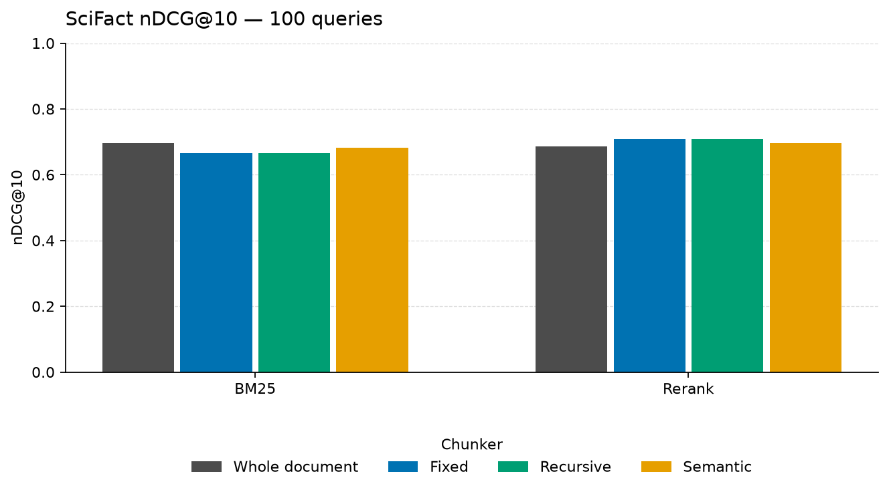

# scifact retrieval results

5,183 documents, 100 labeled queries, mean 1.15 relevant documents per query, mean document length 214.6 words.

## Chunking

| Chunker | Chunks | Avg words | Chunks per doc | Chunk time (s) | Index time (s) |
| --- | ---: | ---: | ---: | ---: | ---: |
| whole | 5,183 | 214.6 | 1.00 | 0.0 | 0.6 |
| fixed | 15,596 | 88.0 | 3.01 | 0.1 | 0.9 |
| recursive | 15,727 | 78.1 | 3.03 | 0.3 | 0.9 |
| semantic | 9,879 | 112.6 | 1.91 | 0.7 | 0.9 |

Index time is shared by every retriever on that chunker. It includes embedding when a dense index is built.

## Retrieval

| Chunker | Retriever | Recall@10 | MRR@10 | nDCG@10 | Context precision@10 | Online latency (ms) |
| --- | --- | ---: | ---: | ---: | ---: | ---: |
| whole | bm25 | 0.790 | 0.677 | 0.696 | 0.671 | 7.4 |
| whole | rerank | 0.820 | 0.657 | 0.687 | 0.645 | 520.3 |
| fixed | bm25 | 0.775 | 0.639 | 0.665 | 0.575 | 17.6 |
| fixed | rerank | 0.840 | 0.675 | 0.708 | 0.621 | 242.7 |
| recursive | bm25 | 0.785 | 0.635 | 0.666 | 0.578 | 16.9 |
| recursive | rerank | 0.850 | 0.671 | 0.708 | 0.618 | 223.4 |
| semantic | bm25 | 0.807 | 0.650 | 0.683 | 0.625 | 11.7 |
| semantic | rerank | 0.807 | 0.666 | 0.696 | 0.631 | 376.4 |

Online latency is the mean of up to 3 single-query calls on this machine, including query embedding. It is not the batched throughput of the full eval.

Metrics are macro-averaged over labeled queries. Recall, MRR, and nDCG are computed after mapping chunks back to documents. Context precision scores the chunks in the order they were retrieved.

## Generation

Model `openai/gpt-4o-mini`, provider `openrouter` judged 100 queries.
Retrieval grid size: 100 queries. Generation sample: 100 queries, context_k=5.
Token counts from the provider: 1260305 input, 46274 output, 1122 calls, 376 cache hits. Estimated cost $0.2168 at $0.15/$0.60 per million.

| Chunker | Retriever | Faithfulness | Answer relevancy | Hallucination rate | Errors |
| --- | --- | ---: | ---: | ---: | ---: |
| whole | bm25 | 0.596 | 0.375 | 0.404 | 0 |
| whole | rerank | 0.598 | 0.363 | 0.402 | 0 |
| fixed | rerank | 0.606 | 0.406 | 0.394 | 1 |
| recursive | rerank | 0.644 | 0.441 | 0.356 | 0 |
| semantic | rerank | 0.635 | 0.451 | 0.365 | 0 |

