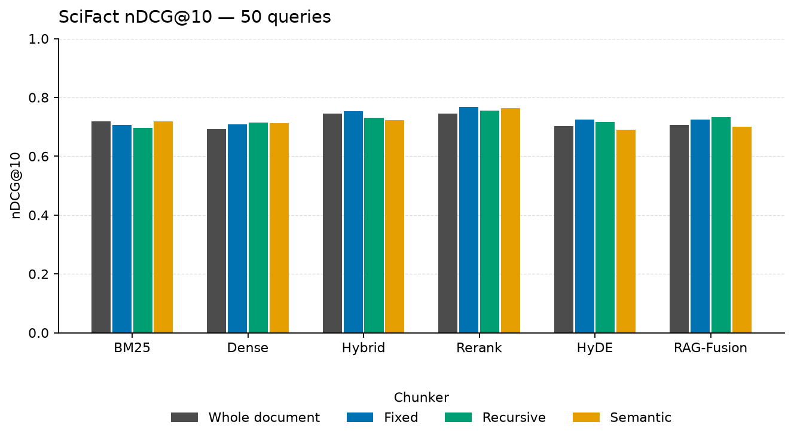

# scifact retrieval results

5,183 documents, 50 labeled queries, mean 1.22 relevant documents per query, mean document length 214.6 words.

## Chunking

| Chunker | Chunks | Avg words | Chunks per doc | Chunk time (s) | Index time (s) |
| --- | ---: | ---: | ---: | ---: | ---: |
| whole | 5,183 | 214.6 | 1.00 | 0.0 | 0.6 |
| fixed | 15,596 | 88.0 | 3.01 | 0.1 | 125.7 |
| recursive | 15,727 | 78.1 | 3.03 | 0.4 | 113.6 |
| semantic | 9,879 | 112.6 | 1.91 | 186.4 | 85.4 |

Index time is shared by every retriever on that chunker. It includes embedding when a dense index is built.

## Retrieval

| Chunker | Retriever | Recall@10 | MRR@10 | nDCG@10 | Context precision@10 | Online latency (ms) |
| --- | --- | ---: | ---: | ---: | ---: | ---: |
| whole | bm25 | 0.805 | 0.713 | 0.719 | 0.703 | 4.1 |
| whole | dense | 0.832 | 0.656 | 0.692 | 0.646 | 11.1 |
| whole | hybrid | 0.864 | 0.715 | 0.745 | 0.707 | 13.4 |
| whole | rerank | 0.869 | 0.726 | 0.745 | 0.701 | 490.7 |
| whole | hyde | 0.856 | 0.658 | 0.703 | 0.653 | 39.9 |
| whole | rag_fusion | 0.852 | 0.664 | 0.707 | 0.662 | 22.8 |
| fixed | bm25 | 0.801 | 0.689 | 0.705 | 0.617 | 9.1 |
| fixed | dense | 0.856 | 0.668 | 0.709 | 0.612 | 16.4 |
| fixed | hybrid | 0.865 | 0.732 | 0.752 | 0.636 | 22.7 |
| fixed | rerank | 0.869 | 0.742 | 0.767 | 0.696 | 204.2 |
| fixed | hyde | 0.856 | 0.695 | 0.725 | 0.613 | 39.0 |
| fixed | rag_fusion | 0.856 | 0.685 | 0.726 | 0.626 | 28.2 |
| recursive | bm25 | 0.781 | 0.677 | 0.696 | 0.610 | 8.9 |
| recursive | dense | 0.832 | 0.689 | 0.714 | 0.611 | 8.2 |
| recursive | hybrid | 0.845 | 0.700 | 0.730 | 0.613 | 30.7 |
| recursive | rerank | 0.869 | 0.723 | 0.755 | 0.675 | 200.9 |
| recursive | hyde | 0.836 | 0.693 | 0.717 | 0.610 | 20.4 |
| recursive | rag_fusion | 0.856 | 0.696 | 0.732 | 0.621 | 22.2 |
| semantic | bm25 | 0.805 | 0.698 | 0.719 | 0.679 | 6.1 |
| semantic | dense | 0.876 | 0.663 | 0.714 | 0.644 | 9.0 |
| semantic | hybrid | 0.820 | 0.697 | 0.722 | 0.659 | 28.5 |
| semantic | rerank | 0.869 | 0.738 | 0.764 | 0.696 | 366.1 |
| semantic | hyde | 0.836 | 0.645 | 0.691 | 0.625 | 19.0 |
| semantic | rag_fusion | 0.856 | 0.647 | 0.701 | 0.637 | 25.7 |

Online latency is the mean of up to 5 single-query calls on this machine, including query embedding. It is not the batched throughput of the full eval.

Metrics are macro-averaged over labeled queries. Recall, MRR, and nDCG are computed after mapping chunks back to documents. Context precision scores the chunks in the order they were retrieved.

HyDE and RAG-Fusion prompts are cached, so the chat model is called once per query rather than once per chunker. online_latency_ms for those rows is measured after the cache is warm and does not include the chat call. The first chunker's eval_seconds does include it.

## Generation

Model `openai/gpt-4o-mini`, provider `openrouter` judged 20 queries.
Retrieval grid size: 50 queries. Generation sample: 20 queries, context_k=5.
Token counts from the provider: 255764 input, 19364 output, 331 calls, 409 cache hits. Estimated cost $0.0500 at $0.15/$0.60 per million.

| Chunker | Retriever | Faithfulness | Answer relevancy | Hallucination rate | Errors |
| --- | --- | ---: | ---: | ---: | ---: |
| whole | bm25 | 0.825 | 0.488 | 0.175 | 0 |
| whole | rerank | 0.833 | 0.426 | 0.167 | 0 |
| fixed | rerank | 0.780 | 0.641 | 0.220 | 0 |
| recursive | rerank | 0.798 | 0.529 | 0.202 | 0 |
| semantic | rerank | 0.855 | 0.589 | 0.145 | 0 |

