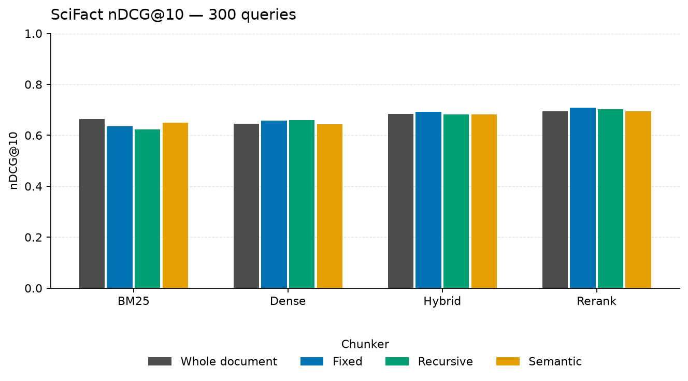

# scifact retrieval results

5,183 documents, 300 labeled queries, mean 1.13 relevant documents per query, mean document length 214.6 words.

## Chunking

| Chunker | Chunks | Avg words | Chunks per doc | Chunk time (s) | Index time (s) |
| --- | ---: | ---: | ---: | ---: | ---: |
| whole | 5,183 | 214.6 | 1.00 | 0.0 | 0.8 |
| fixed | 15,596 | 88.0 | 3.01 | 0.1 | 1.1 |
| recursive | 15,727 | 78.1 | 3.03 | 0.7 | 244.5 |
| semantic | 9,879 | 112.6 | 1.91 | 393.0 | 165.0 |

Index time is shared by every retriever on that chunker. It includes embedding when a dense index is built.

## Retrieval

| Chunker | Retriever | Recall@10 | MRR@10 | nDCG@10 | Context precision@10 | Online latency (ms) |
| --- | --- | ---: | ---: | ---: | ---: | ---: |
| whole | bm25 | 0.785 | 0.633 | 0.664 | 0.628 | 6.9 |
| whole | dense | 0.783 | 0.605 | 0.645 | 0.599 | 17.4 |
| whole | hybrid | 0.815 | 0.647 | 0.685 | 0.644 | 16.2 |
| whole | rerank | 0.819 | 0.664 | 0.693 | 0.656 | 993.9 |
| fixed | bm25 | 0.767 | 0.599 | 0.634 | 0.539 | 17.1 |
| fixed | dense | 0.819 | 0.611 | 0.658 | 0.562 | 21.5 |
| fixed | hybrid | 0.831 | 0.652 | 0.693 | 0.587 | 36.8 |
| fixed | rerank | 0.834 | 0.675 | 0.708 | 0.612 | 379.3 |
| recursive | bm25 | 0.755 | 0.586 | 0.623 | 0.529 | 15.5 |
| recursive | dense | 0.817 | 0.616 | 0.660 | 0.552 | 20.9 |
| recursive | hybrid | 0.808 | 0.644 | 0.682 | 0.577 | 36.7 |
| recursive | rerank | 0.838 | 0.666 | 0.703 | 0.607 | 360.6 |
| semantic | bm25 | 0.780 | 0.612 | 0.649 | 0.583 | 10.1 |
| semantic | dense | 0.812 | 0.592 | 0.644 | 0.553 | 8.1 |
| semantic | hybrid | 0.812 | 0.645 | 0.682 | 0.607 | 18.5 |
| semantic | rerank | 0.819 | 0.663 | 0.694 | 0.620 | 717.5 |

Online latency is the mean of up to 10 single-query calls on this machine, including query embedding. It is not the batched throughput of the full eval.

Metrics are macro-averaged over labeled queries. Recall, MRR, and nDCG are computed after mapping chunks back to documents. Context precision scores the chunks in the order they were retrieved.

## Generation

Generation metrics, HyDE, and RAG-Fusion did not run. run with API key: set RAGBENCH_API_KEY or OPENAI_API_KEY. Optional RAGBENCH_API_BASE (default https://api.openai.com/v1) and RAGBENCH_LLM_MODEL (default gpt-4o-mini).

